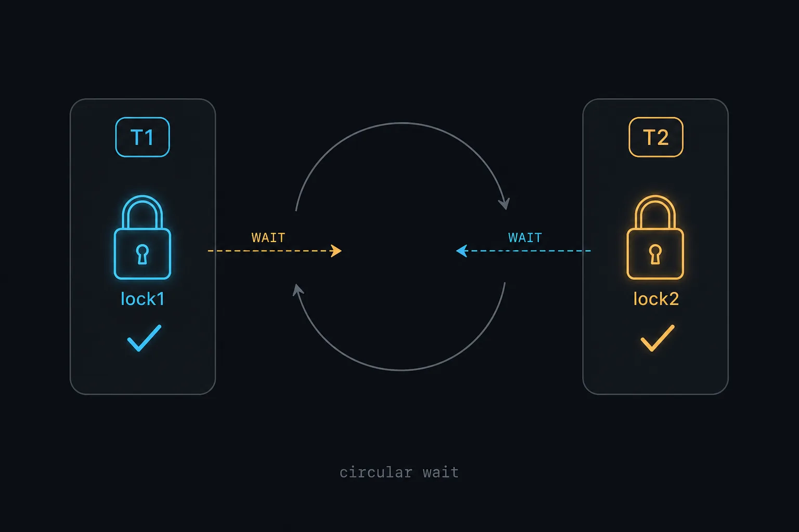
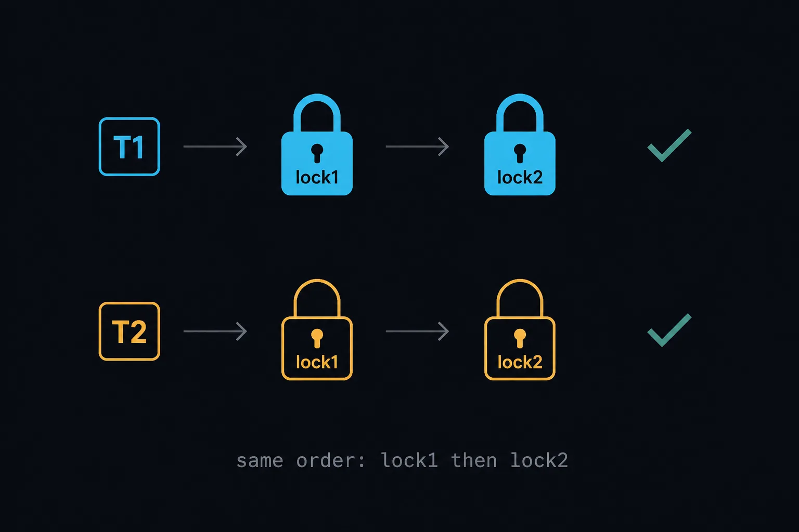

死锁不用讲得很复杂。最简单的情况就是：两个线程各拿一把锁，再去抢对方手里那把。

`synchronized` 是排他锁，同一时刻只有一个线程能持有。线程 1 已经拿到 `lock1`，线程 2 再来拿就只能等。反过来也一样。两边都等着对方释放，谁也走不到释放锁的那一行，这就死了。

## 最小例子

```java title="DeadLockDemo.java" showLineNumbers
public class DeadLockDemo {

    private static final Object lock1 = new Object();
    private static final Object lock2 = new Object();

    public static void main(String[] args) {
        Thread t1 = new Thread(() -> {
            synchronized (lock1) {
                System.out.println("thread1 get lock1");
                System.out.println("thread1 try to get lock2");
                synchronized (lock2) {
                    System.out.println("thread1 get lock2");
                }
            }
        });

        Thread t2 = new Thread(() -> {
            synchronized (lock2) {
                System.out.println("thread2 get lock2");
                System.out.println("thread2 try to get lock1");
                synchronized (lock1) {
                    System.out.println("thread2 get lock1");
                }
            }
        });

        t1.start();
        t2.start();
    }
}
```

:::tip
这段代码不一定每次都能复现。如果某一个线程跑得特别快，可能在另一个线程启动前就把两把锁都拿完了。想稳定看到死锁，可以在拿到第一把锁之后加一行 `Thread.sleep(100)`。
:::

## 发生了什么

1. T1 拿到 `lock1`，打印 `thread1 get lock1`
2. T2 拿到 `lock2`，打印 `thread2 get lock2`
3. T1 去拿 `lock2`，被挡住
4. T2 去拿 `lock1`，被挡住

接下来两边都卡在内层 `synchronized` 上。外层那把锁一直握在手里，释放逻辑永远执行不到。



```
T1 持有 lock1 → 等 lock2
                  ↑
                  │
T2 持有 lock2 → 等 lock1
```

## 死锁的四个条件

四个条件同时成立，才会死锁。缺一个都不行。

- **互斥**：`lock1` / `lock2` 同一时间只能被一个线程持有
- **持有并等待**：线程已经拿到一把锁，同时还在等另一把
- **不可剥夺**：T2 不能把 T1 手里的 `lock1` 抢走，只能等 T1 自己释放
- **循环等待**：T1 等 T2，T2 又等 T1，围成一圈

## 怎么解开

最直接的办法是破坏循环等待：两个线程按同一顺序加锁。

- 线程 1：`lock1` → `lock2`
- 线程 2：`lock1` → `lock2`



```java title="DeadLockFixedDemo.java" showLineNumbers
public class DeadLockFixedDemo {

    private static final Object lock1 = new Object();
    private static final Object lock2 = new Object();

    public static void main(String[] args) {
        Thread t1 = new Thread(() -> {
            synchronized (lock1) {
                System.out.println("thread1 get lock1");
                synchronized (lock2) {
                    System.out.println("thread1 get lock2");
                }
            }
        });

        Thread t2 = new Thread(() -> {
            synchronized (lock1) {
                System.out.println("thread2 get lock1");
                synchronized (lock2) {
                    System.out.println("thread2 get lock2");
                }
            }
        });

        t1.start();
        t2.start();
    }
}
```

这样最多出现其中一个线程排队等另一把锁，不会再围成圈。等前面的线程用完释放，后面的就能继续走。

:::note
超时、`tryLock`、缩小锁范围也能避免死锁。这篇只讲最简单的一种：把加锁顺序统一掉。
:::
